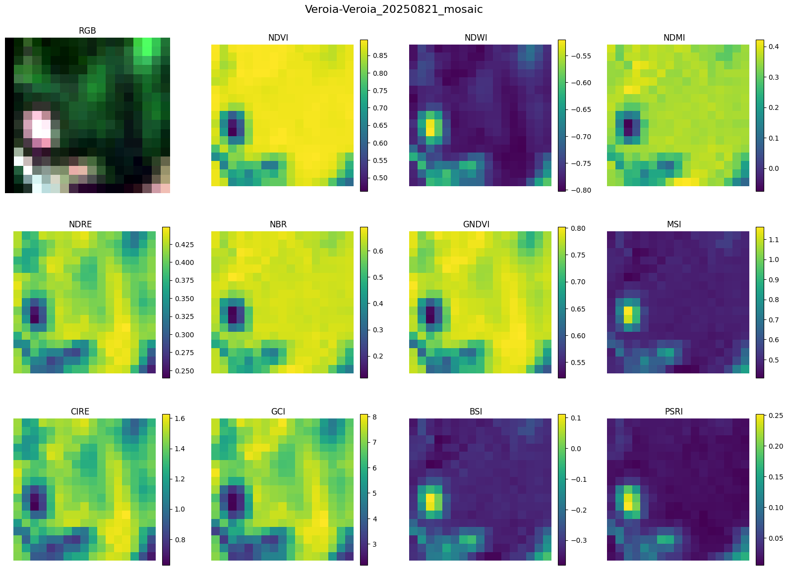
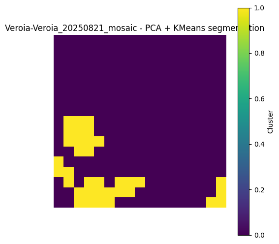
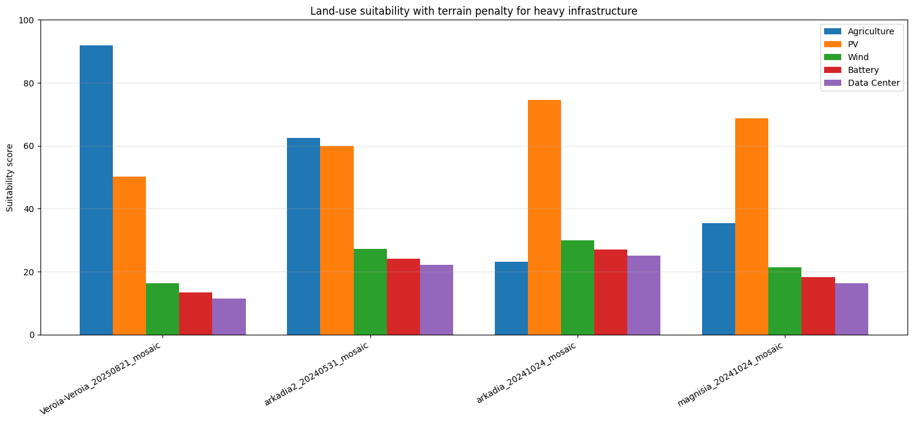

# E-STATE | Real Estate Beyond RGB

**Award-winning FLUXE Makeathlon team prototype** combining hyperspectral image analysis, unsupervised ML and a multi-agent LLM application to explore land-investment alternatives across Greece.

> **Makeathlon winning team project (2026)** · ICCS / i-SENSE · Research/hackathon prototype, **not production financial advice**.



## The challenge

Could an investor compare potential land uses beyond what traditional RGB imagery and a property listing reveal? E-STATE brings together parcel-level spectral features, environmental and infrastructure context, investor preferences, and an LLM-based explanation workflow. The supported demonstration use cases are **agriculture, photovoltaics, wind, battery storage and data centers**.

## How the prototype works

```text
EnMAP hyperspectral scenes / metadata + supporting resource tables
         |
         v
Offline analysis (Python, rasterio, NumPy, pandas)
  - spectral indices and feature engineering
  - StandardScaler -> PCA -> K-Means segmentation (experiment)
  - heuristic suitability scoring and prototype enrichment
         |
         v
Precomputed parcel records / demonstration seed data
         |
         v
PostgreSQL + PostGIS <- FastAPI <- LangChain/Azure OpenAI agents
                                          |
                                          v
                                React + TypeScript dashboard
```

The notebook and the app are **separate workflows**: the original hackathon backend ships with precomputed/seeded demonstration parcels; it does **not** invoke the notebook each time a user asks a question.

## Key components

| Component | Implementation |
| --- | --- |
| Hyperspectral exploration | EnMAP GeoTIFF bands and XML metadata; NDVI, NDWI, NDMI, NDRE, NBR, GNDVI, BSI and other indices |
| Unsupervised learning | Pixel features, StandardScaler, PCA, K-Means clustering; notebook experiment for a selected scene |
| Heuristic scoring | Prototype weighted land-use rankings with PVGIS/wind inputs and demo infrastructure/terrain assumptions |
| Investor profiling | LangChain structured-output agent gathers budget, target region, risk preferences and land-use category |
| Financial & risk analysis | LLM-generated **illustrative estimates and risk summaries** (not verified financial forecasts) |
| Recommendation | LangChain decision agent compares and explains top candidates |
| Application | FastAPI streaming API, PostgreSQL/PostGIS, React, TypeScript, Leaflet, Docker Compose |

### ML example: pixel clustering



### Example prototype suitability scores



## Repository structure

```text
.
├── backend/                # FastAPI application, agent orchestration, SQL schema and seed data
├── frontend/               # React/TypeScript app and map UI
├── ml/
│   ├── hyperspectral_analysis.ipynb  # Exploratory offline analysis
│   ├── README.md
│   └── requirements.txt
├── docs/images/            # Curated notebook output figures
├── .env.example            # Placeholder local configuration (no secrets)
├── docker-compose.yml
└── README.md
```

## Run the app locally

Prerequisites: Docker with Compose, and access to an **Azure OpenAI deployment**.

```bash
cp .env.example .env
# Edit .env with your Azure OpenAI endpoint, key and deployment name.
docker compose up --build
```

On Windows PowerShell, use `Copy-Item .env.example .env` instead of `cp` if necessary. Then visit:

- Frontend: http://localhost:5173
- API health: http://localhost:8000/health

The database is seeded automatically at startup. The seeded inventory includes **four challenge-derived parcels and six synthetic demonstration parcels**. Prices and plot footprints are prototype defaults rather than market listings. The frontend expects a backend URL through `VITE_API_BASE_URL` for external deployments; locally it uses the Vite `/api` proxy.

### Offline ML workflow

See [`ml/README.md`](ml/README.md) and [`hyperspectral_analysis.ipynb`](ml/hyperspectral_analysis.ipynb). The notebook requires separate raw EnMAP/metadata imagery and supplemental PVGIS/wind/infrastructure inputs that are **not bundled** in this repository. It contains exploratory cells and cannot be rerun end-to-end using only the supplied files.

## Transparency / limitations

This was built under Makeathlon time constraints. It is a **proof of concept** rather than a deployable investment-planning tool:

- The notebook's K-Means segmentation is exploratory, not validated supervised ML.
- Suitability rankings rely on **heuristic rules and weights**; some terrain/grid inputs are synthetic. A demo-specific ranking cap on battery/data-center scores appears in the original notebook and has not been treated as a scientifically justified model.
- The LLM's financial projections have not been independently validated. Actual land use depends on zoning, environmental constraints, utilities, permitting, ownership and site-level due diligence.
- Raw scenes and several external supporting datasets are missing from this upload; the precomputed demonstration data is sufficient for the application's demo, but not for full scientific reproducibility.
- The original project has no automated test suite beyond a placeholder.

## Team and acknowledgment

Developed collaboratively for the **FLUXE Makeathlon** challenge, "Real Estate Beyond RGB" (ICCS / i-SENSE). Team members, retained from the original submission:

- Nikolaos Katsaidonis — ECE NTUA
- Georgios Tzamouranis — ECE NTUA
- Panagiotis Bampatsias — ECE NTUA
- Basilis Koulouridis — ECE NTUA
- Kyriakos Katsaidramis — ECE NTUA

This repository presents the **team's** project; individual contribution details should be added only after confirmation by contributors. No license is asserted for third-party input data or code beyond what the respective owners provide.
